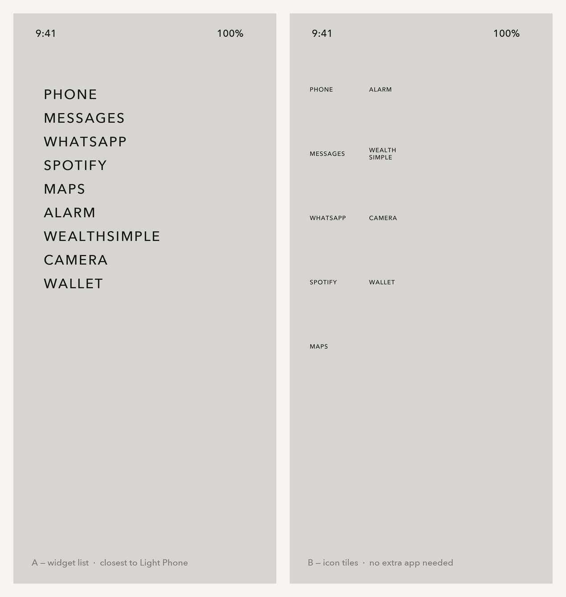

# Light Phone mode for iPhone

Turn an iPhone into something close to a [Light Phone II](https://www.thelightphone.com/):
nine tools, an e-ink text list, no feed, no browser, no notifications.


No jailbreak, no app to install besides [Scriptable](https://scriptable.app) (free).
Everything here is a widget script, a set of generated images, and a configuration
walkthrough.

---

## Why a widget, and not icons

The obvious approach is to give each app a custom icon containing its name, set against
a matching wallpaper so the icon squares disappear. I built that first. It doesn't work,
for a reason that's worth stating plainly:

**A home-screen icon is capped at about 60pt.** A word rendered inside one comes out
*smaller* than the stock app label beneath it, and the 96pt row pitch scatters the words
into a grid. It reads as a sparse page of icons, not a list.



A Large widget gets a ~338×354pt canvas. Nine rows fit at 21pt with tight leading, and
`WidgetStack.url` makes each row its own tap target. That's the whole trick: the Light
Phone look needs a canvas the icon grid can't give you.

The icon-tile assets ship here anyway, under `assets/tiles/`, for anyone who'd rather not
install Scriptable.

---

## What's here

```
widget/LightPhone.js        the widget — edit the TOOLS list and you're done
tools/generate_assets.py    regenerates every image for your own app list
assets/wallpapers/          flat e-ink backgrounds, light and inverted
assets/tiles/               word tiles + blank tiles for the icon route
assets/previews/            the mockups above
docs/SETUP.md               the full walkthrough: Focus, grayscale, Screen Time
```

---

## Install

Roughly fifteen minutes, most of it making shortcuts.

**1. Shortcuts.** The widget routes each row through Shortcuts so it never depends on an
undocumented URL scheme. Make nine, each one action — `Open App` → the app — named
exactly `LP Phone`, `LP WhatsApp`, `LP Spotify`, `LP Maps`, `LP Tesla`,
`LP Wealthsimple`, `LP Yahoo Finance`, `LP Camera`, `LP Wallet`.

**2. Widget.** Install Scriptable, add a new script, paste in the *contents* of
[`widget/LightPhone.js`](widget/LightPhone.js), name it `Light Phone`. Add a **Large**
Scriptable widget to an empty Home Screen page and point it at that script.

> On the phone, open the file on GitHub and tap the **copy-raw** button in the file
> toolbar — the two-overlapping-squares icon. Pasting the file's *link* into Scriptable
> gives you `SyntaxError: Unexpected token`, because Scriptable tries to run the URL as
> code.

**3. Wallpaper.** Save `assets/wallpapers/wallpaper-light.png` (or `-dark`) to Photos and
set it as your wallpaper. On a phone, open the file on GitHub and long-press the image to
save it. Turn off Depth Effect and remove every Lock Screen widget.

**4. Focus.** Build a custom Focus that shows only that one Home Screen page and allows
notifications from nobody. Full settings in [docs/SETUP.md](docs/SETUP.md).

**5. Grayscale.** Accessibility → Display & Text Size → Color Filters → Grayscale, then a
Shortcuts automation to flip it with the Focus.

**6. The lock.** Screen Time Downtime with only your nine apps allowed, and a Screen Time
passcode that isn't your device passcode. Without this step the mode is decoration — you
can still swipe to App Library. With it, there's a real gap between impulse and access.

---

## Make it yours

Edit the `TOOLS` array at the top of `LightPhone.js` — label, shortcut name, optional
native URL scheme:

```js
const TOOLS = [
  ["PHONE",    "LP Phone",    "mobilephone://"],
  ["NOTES",    "LP Notes",    null],
];
```

Two settings sit above it:

| Setting | Options | Effect |
|---|---|---|
| `MODE` | `"auto"` / `"light"` / `"dark"` | `auto` follows system appearance, so the widget flips with your Focus |
| `FORCE_SHORTCUTS` | `true` / `false` | `true` always works; `false` uses native schemes where available, which launch instantly with no Shortcuts flash |

Then regenerate the images to match:

```bash
pip install -r requirements.txt
python3 tools/generate_assets.py --words PHONE MESSAGES NOTES MUSIC MAPS
```

The generator picks **one** type size for the whole set, large enough that the longest
word still fits. Sizing each tile independently is what made the first attempt look
ragged. Words over nine characters break onto two balanced lines. `--paper` and `--ink`
take any hex pair, `--wallpaper-size` any `WxH`.

---

## What iOS won't let you automate

Worth knowing before you imagine shipping this as an app:

- **No app can** set your wallpaper, rearrange the Home Screen, create or activate a Focus,
  or toggle grayscale. Those stay manual, which is why step 3 through 5 are instructions
  rather than code.
- **Blocking is the one automatable part**, via `FamilyControls` / `ManagedSettings`. It
  needs Apple's Family Controls distribution entitlement, granted per target and reportedly
  slow to arrive.
- The Shortcuts **Set Wallpaper** action exists but has been unreliable since iOS 18, so
  this repo doesn't lean on it. Pair a wallpaper with a Focus-linked Lock Screen instead.

Tested on iOS 18. Earlier versions lack per-Focus Home Screen pages, which the whole
approach depends on.

## Licence

MIT — see [LICENSE](LICENSE).
